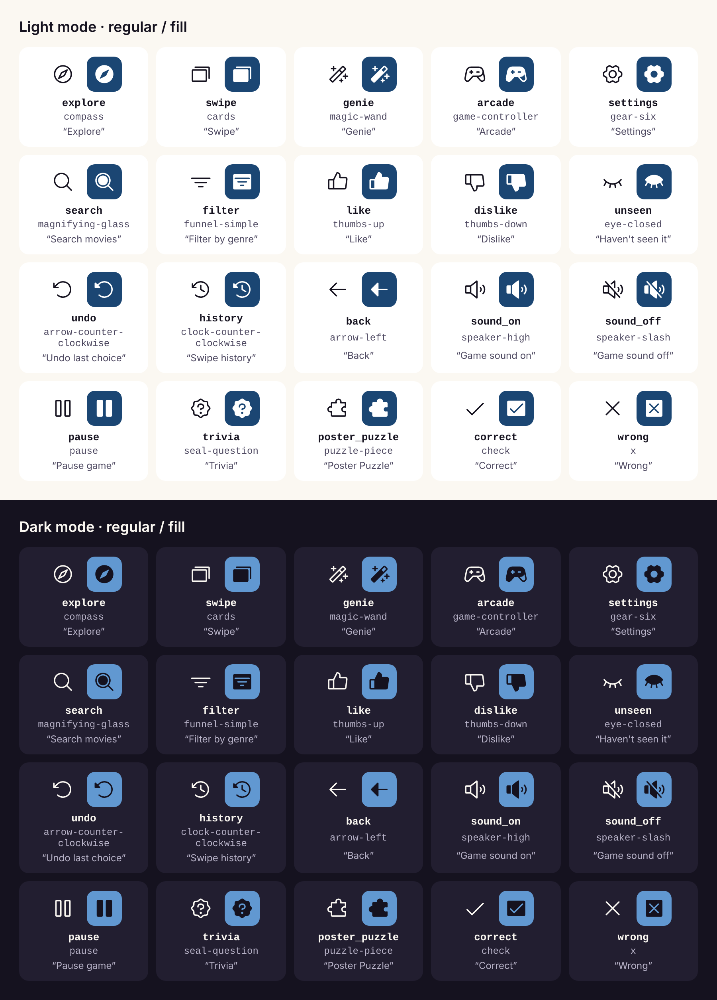

# PopcornPilot UI icons

These are the 20 UI icons both apps share. They are copied from [Phosphor Icons](https://phosphoricons.com) `@phosphor-icons/core` v2.1.1 (MIT, see `LICENSE`). None of them were redrawn. The rules for using them are in section 6 of the brand manual.



## What's in this folder

```
icons/
├── regular/   inactive state (tabs that aren't selected, buttons)
├── fill/      selected state (the active tab, a liked film, the active filter)
└── LICENSE    Phosphor's MIT license. Ship it with the apps.
```

**About the fill folder:** for line-only icons, Phosphor's fill version puts the line inside a solid rounded square. That happens for `filter`, `back`, `undo`, `history`, `correct` and `wrong`. Those six are rarely in a selected state, so use `regular` for them and show selection with a chip or a color change.

Each file is a 24 × 24 SVG with a solid black fill. Both platforms tint icons at runtime, so the black never shows on screen.

### Why the files use app names instead of Phosphor names

The files are named after what they *do* in the app (`unseen.svg`), not after what they show (`eye-closed.svg`). Code then refers to `R.drawable.unseen` or `Image("unseen")`. If the drawing changes later, say Unseen becomes a clapperboard after you test it in the UI, you only swap the file. No Swift or Kotlin code changes. The table below records which Phosphor icon each name comes from.

The names use `snake_case` because Android resource names can only contain lowercase letters, numbers and underscores. Xcode accepts them too.

## Icon map and accessibility labels

| App name | Phosphor icon | Where it's used | Accessibility label | Possible misreading |
|---|---|---|---|---|
| `explore` | `compass` | Tab | "Explore" (the tab title) | None |
| `swipe` | `cards` | Tab | "Swipe" (the tab title) | Could look like "copy". Its tab label fixes that. |
| `genie` | `magic-wand` | Tab | "Genie" (the tab title) | Could look like "edit" or "auto-fix" in photo apps. Its tab label fixes that. |
| `arcade` | `game-controller` | Tab | "Arcade" (the tab title) | None |
| `settings` | `gear-six` | Top bar | "Settings" | None |
| `search` | `magnifying-glass` | Explore | "Search movies" | Could look like "zoom" |
| `filter` | `funnel-simple` | Explore | "Filter by genre" | Sort also needs its own icon if it gets one. Don't use this one for both. |
| `like` | `thumbs-up` | Swipe, Details | "Like" | None. Always pair it with the `positive` color. |
| `dislike` | `thumbs-down` | Swipe, Details | "Dislike" | None |
| `unseen` | `eye-closed` | Swipe, Details | "Haven't seen it" | **Watch this one.** It could read as "hide" or "sleep". Show a visible text label, and test it in the UI. Its fill weight turns into a blob, so use `regular` in both states and show the selected state with a filled chip behind it. |
| `undo` | `arrow-counter-clockwise` | Swipe | "Undo last choice" | Looks similar to History. Don't put them next to each other without labels. |
| `history` | `clock-counter-clockwise` | Swipe | "Swipe history" | See Undo |
| `back` | `arrow-left` | Details, games | "Back" | None. On iOS, prefer the system back button, which provides its own icon and label. |
| `sound_on` | `speaker-high` | Settings, games | "Game sound on" | None |
| `sound_off` | `speaker-slash` | Settings, games | "Game sound off" | None |
| `pause` | `pause` | Games | "Pause game" | None |
| `trivia` | `seal-question` | Arcade hub | "Trivia" | Question marks usually mean Help, so only use it next to the "Trivia" title |
| `poster_puzzle` | `puzzle-piece` | Arcade hub | "Poster Puzzle" | Can mean "plugins" elsewhere. It's always shown with its title here. |
| `correct` | `check` | Trivia feedback | "Correct" | None. Always pair it with color and text. |
| `wrong` | `x` | Trivia feedback | "Wrong" | Can mean "close". Always pair it with color and text. |

**Label tips:**
- A tab with a visible title uses that title, so the icon itself is hidden from VoiceOver and TalkBack.
- Toggle buttons such as Like or Sound announce their state, for example "Like, selected". That way the label doesn't have to change.
- On Android, pass the label as `contentDescription`. On iOS, use `.accessibilityLabel(...)`. Pass `null` or `.accessibilityHidden(true)` for decorative icons.

## Adding them to the apps

**Android (Compose):** In Android Studio, go to File › New › Vector Asset › Local file. Pick a file from `regular/` and name it `ic_<name>`, or `ic_<name>_fill` for files from `fill/`. Studio converts it to a Vector Drawable in `res/drawable`. Use it like this:

```kotlin
Icon(
    painter = painterResource(R.drawable.ic_like),
    contentDescription = "Like",
    tint = MaterialTheme.colorScheme.primary,
)
```

**iOS (SwiftUI):** Drag a file into `Assets.xcassets`. In the Attributes inspector, set **Render As** to *Template Image* and turn on **Preserve Vector Data**. Name it `like` or `like.fill`. Use it like this:

```swift
Image("like")
    .foregroundStyle(Color.accentColor)
    .accessibilityLabel("Like")
```

Doing this by hand works for 40 files. A good dev-script exercise later is a small script that converts this folder into both formats in one go, so the apps never drift apart.
