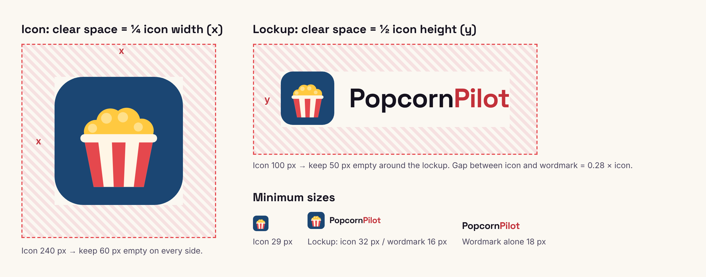
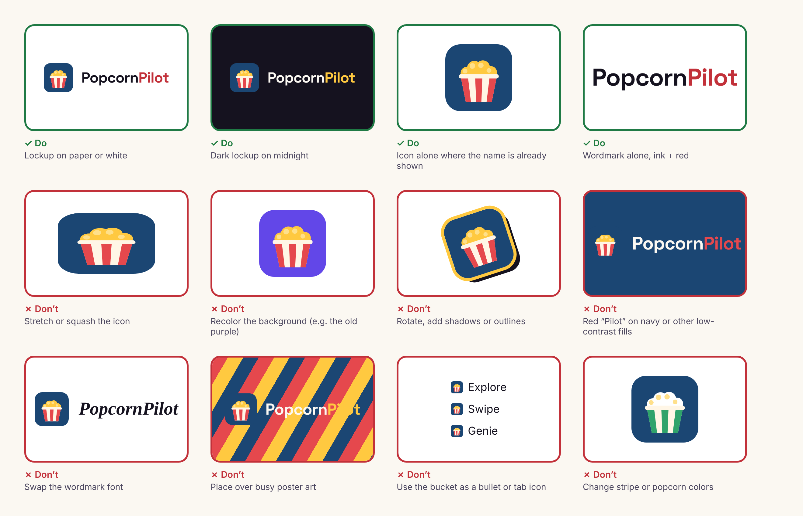
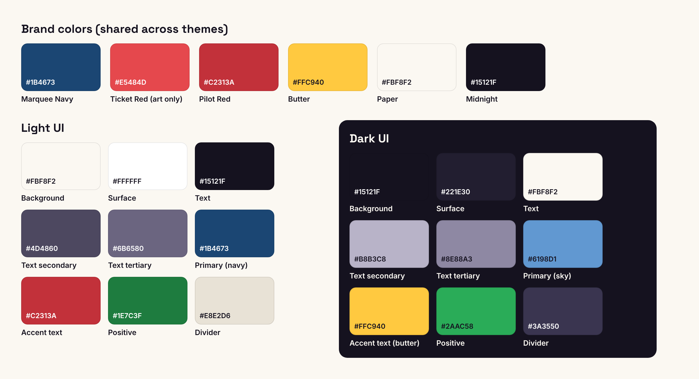
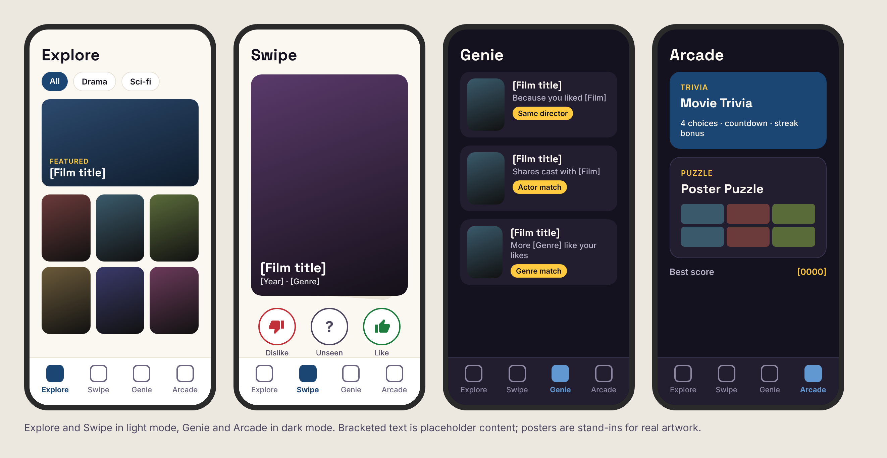

# PopcornPilot brand manual

**Version 1.0, 17 Nov 2026.** This manual covers PopcornPilot, a film discovery app for iOS (SwiftUI) and Android (Kotlin). It's a personal learning project and won't be published.

**What changed in v0.2:**
- Your approvals are applied.
- Every color pair this manual allows for text measures at least 4.5:1, against the WCAG 2.2 AA target.
- All decisions are approved and listed in [section 10](#10-open-items).

Files that go with this manual:
- `assets/popcornpilot-icon.svg`: the app icon, used in both light and dark mode
- `images/`: the reference images used below

---

## 1. Brand personality

**In one line:** your film-buff friend with a bucket of popcorn. They know a lot about movies, but they never make you feel like you don't. *(Approved.)*

| We are | We are not |
|---|---|
| **Playful.** Popcorn, arcade games, a genie. | Childish or full of jokes. Film is still treated with care. |
| **Helpful.** Every recommendation says *why*. | Pushy. No "you HAVE to watch this." |
| **Warm.** Paper, butter yellow, a friendly round typeface. | Cold, techy or neon. |
| **Clear.** Short labels and obvious next steps. | Clever at the cost of being understood. |

**How it sounds in the app:**
- Empty Genie: "Like or dislike a few films and I'll start picking for you." *(not "No data available.")*
- Offline with no catalog yet: "PopcornPilot needs one connection to load the film catalog. After that it works offline."
- A correct trivia answer: "Nailed it! +2 streak bonus."

---

## 2. Logo

The identity has three parts, and each one can be used on its own:

1. **Icon:** the striped popcorn bucket on a Marquee Navy tile. This is the app icon and the smallest form of the brand.
2. **Wordmark:** "Popcorn" plus "Pilot", set in Space Grotesk Bold with letter-spacing of −2%.
   - On light backgrounds: "Popcorn" in ink `#15121F`, "Pilot" in Pilot Red `#C2313A`.
   - On dark backgrounds: "Popcorn" in paper `#FBF8F2`, "Pilot" in butter `#FFC940`.
3. **Lockup:** the icon and the wordmark side by side. The gap between them is 0.28 × the icon's width, and the wordmark's size is 0.5 × the icon's height.

**Where each one goes:**
- **Lockup:** splash screen, onboarding, About screen, README header.
- **Icon:** the home screen, and anywhere the name is already written next to it.
- **Wordmark:** headers that are too short for the icon.

### Clear space and minimum sizes

| Part | Clear space (keep empty) | Minimum size |
|---|---|---|
| Icon | **x** = ¼ of the icon's width, on every side | **29 pt** (the smallest iOS icon slot) |
| Lockup | **y** = ½ of the icon's height, on every side | icon at **32 pt**, wordmark at 16 pt |
| Wordmark alone | the height of the letter "P", on every side | **18 pt** |

These sizes are final.

- **Clear space** stops other content from crowding the logo, so it still reads as one shape.
- **Minimum sizes:** I picked these by rendering the icon at 29, 40 and 60 px. At 29 px the stripes and the popcorn are still clear. Below that, the bucket starts to blur into a single blob.

### Correct and incorrect use

- **Do** place the lockup on paper, white or midnight.
- **Do** use the icon alone when the name is already nearby.
- **Don't** stretch, rotate, outline, add shadows to, or recolor the icon. That includes changing its background back to purple.
- **Don't** put red "Pilot" on navy. Use the dark-mode wordmark colors there instead.
- **Don't** put the logo over poster art.
- **Don't** swap in another font.
- **Don't** use the bucket as a tab icon or a bullet point.
- **Don't** change the stripe or popcorn colors.

### App icon

There's **one icon for both modes**: the navy tile (approved). iOS 18 can show a separate dark icon, but we use the same artwork for light and dark. A tinted version (the bucket shape in one color) gets exported when we build icons.

**Platform notes:**
- **Android:** adaptive icons crop the outer edge into different shapes. Their safe zone is a circle 66 dp across on a 108 dp canvas, so the bucket will probably need to shrink a little for the foreground layer. I'll check this during export.
- **iOS:** rounds the corners itself, so export the icon as a full square.

---

## 3. Color

### Brand colors

| Name | Hex | RGB | Role |
|---|---|---|---|
| Marquee Navy | `#1B4673` | 27, 70, 115 | Icon background, primary color in light mode, card fill in both modes |
| Ticket Red | `#E5484D` | 229, 72, 77 | **Art only:** the icon's stripes and illustrations. Never for text, and never behind text. |
| Pilot Red | `#C2313A` | 194, 49, 58 | "Pilot" in the wordmark, red text, Dislike and error states in light mode |
| Butter | `#FFC940` | 255, 201, 64 | Popcorn, badges, scores. Text in butter is allowed **only on dark or navy backgrounds**. |
| Paper | `#FBF8F2` | 251, 248, 242 | Light-mode background **and** dark-mode text (one shared color) |
| Midnight | `#15121F` | 21, 18, 31 | Light-mode text, dark-mode background |

> The icon artwork keeps its original cream `#FFF6E6` on the bucket stripes and rim. That color belongs to the illustration and isn't a UI token.

### UI tokens

| Token | Light | Dark | Use |
|---|---|---|---|
| `background` | `#FBF8F2` paper | `#15121F` midnight | Screen background |
| `surface` | `#FFFFFF` | `#221E30` | Cards, sheets, the tab bar |
| `text.primary` | `#15121F` | `#FBF8F2` | Body text and titles |
| `text.secondary` | `#4D4860` | `#B8B3C8` | Metadata, captions |
| `text.tertiary` | `#6B6580` | `#8E88A3` | Inactive tabs, hints |
| `primary` | `#1B4673` navy | `#6198D1` Marquee Sky | Selected tab, links, primary buttons |
| `onPrimary` | `#FFFFFF` | `#15121F` | Text and icons on a `primary` fill |
| `accent.text` | `#C2313A` Pilot Red | `#FFC940` butter | Dislike, errors, and the "Pilot" part of the wordmark |
| `highlight` | `#FFC940` (fill only) | `#FFC940` | Badges. Always put `#15121F` text on top. |
| `positive` | `#1E7C3F` | `#2AAC58` | Like, correct answers. Always paired with an icon (thumbs-up or check). |
| `onPositive` | `#FFFFFF` | `#15121F` | Text on a `positive` fill |
| `divider` | `#E8E2D6` | `#3A3550` | Decorative lines only |
| `control.border` | `#8A8499` | `#6E6888` | Outlines on inputs and toggles, which have to be visible |

**Why these choices:**
- **Marquee Sky `#6198D1`:** this is the navy's exact hue (211°), just lighter, so it reads as the same family as the icon. It's darker and closer to the navy than the earlier `#8DB8E8`, and still measures 6.08:1 on midnight and 5.34:1 on dark surfaces.
- **Butter for dark-mode accents** instead of the pinkish `#FF7A7E`. It's already a brand color and measures 12.02:1 on midnight. Because butter and Pilot Red mean "attention" here, Dislike and errors must always carry an icon or text as well, never color alone.
- **Paper for both themes:** `#FBF8F2` beat the old cream `#FFF6E6` both ways. It's 17.41:1 against midnight in both directions, compared with 17.20:1 for cream.
- **Green for "Like":** `#1E7C3F` in light mode (your pick: 4.94:1 on paper, 5.24:1 on white) and `#2AAC58` in dark mode. The dark green is the same hue (141°) and saturation, just lighter, and measures 6.27:1 on midnight and 5.51:1 on dark surfaces. Both and both are always shown with a thumbs-up, as you suggested for people with color blindness.

**Building it:** put these into an asset catalog color set (iOS) and `colors.xml` with a `values-night` override (Android). Reference the tokens in code, never raw hex values.

### Color rules (where each color may appear)

1. **Ticket Red `#E5484D` is for artwork only.** It's never used as text and never sits behind text. Red text uses Pilot Red in light mode and butter in dark mode.
2. **Never use butter as text or as an icon on paper, white or any light background** (1.45 to 1.54:1). In light mode, butter can only be a fill with ink text on top.
3. **Navy text and lines are light-mode only.** In dark mode, use Marquee Sky. Navy can still be a card fill in dark mode, with paper or butter text on it.
4. **Navy cards in dark mode need a text label.** The card's edge against midnight is only 1.91:1, so the label is what makes the card recognizable, not its outline.
5. **Dividers are decorative.** Anything a user has to see to use a control, such as an input's outline or a toggle track, uses `control.border`.
6. **Never use color as the only signal.** Like, Dislike, correct, wrong and errors always come with an icon and a text or accessibility label.
7. **Text over posters needs a scrim** (see section 7). Poster colors can't be predicted, so they can't be pre-checked.

---

## 4. Contrast report

**How I measured:** I calculated each ratio from its hex values with the WCAG 2.x relative-luminance formula, rounded to two decimals. The targets are WCAG 2.2 AA:
- 1.4.3: 4.5:1 for normal text, 3:1 for large text (18 pt regular or 14 pt bold and up)
- 1.4.11: 3:1 for UI parts and graphics that matter

**Every pair the guidelines allow for text measures at least 4.5:1.** The lowest is tertiary text on a dark surface, at 4.78:1. The rows marked 🚫 are combinations the rules above don't allow. They're listed so it's clear why.

> **This is not an accessibility compliance claim.** These numbers only show that the *color pairs* meet the ratio targets. Compliance also depends on the built screens: text over poster images, Dynamic Type and font scaling, screen-reader labels, focus order, touch-target size, and more. That needs testing on devices, for example with Xcode's Accessibility Inspector, Android's Accessibility Scanner, VoiceOver and TalkBack.

### Light mode

| Pair (foreground on background) | Ratio | Normal text ≥ 4.5 | Large text / UI ≥ 3.0 | Allowed use |
|---|---|---|---|---|
| Text `#15121F` on paper `#FBF8F2` | 17.41 | ✅ | ✅ | Text |
| Text `#15121F` on surface `#FFFFFF` | 18.45 | ✅ | ✅ | Text |
| Secondary `#4D4860` on paper | 8.22 | ✅ | ✅ | Text |
| Secondary `#4D4860` on surface | 8.71 | ✅ | ✅ | Text |
| Tertiary `#6B6580` on paper | 5.22 | ✅ | ✅ | Text |
| Tertiary `#6B6580` on surface | 5.53 | ✅ | ✅ | Text |
| Navy `#1B4673` on paper | 9.13 | ✅ | ✅ | Text |
| Navy `#1B4673` on surface | 9.68 | ✅ | ✅ | Text |
| White `#FFFFFF` on navy (button, chip) | 9.68 | ✅ | ✅ | Text |
| Paper `#FBF8F2` on navy (Arcade card) | 9.13 | ✅ | ✅ | Text |
| Butter `#FFC940` on navy (overline) | 6.30 | ✅ | ✅ | Text |
| Pilot Red `#C2313A` on paper (text, wordmark) | 5.22 | ✅ | ✅ | Text |
| Pilot Red `#C2313A` on surface | 5.53 | ✅ | ✅ | Text |
| White on Pilot Red `#C2313A` (button) | 5.53 | ✅ | ✅ | Text |
| Ink `#15121F` on butter `#FFC940` (badge) | 12.02 | ✅ | ✅ | Text |
| Green `#1E7C3F` on paper | 4.94 | ✅ | ✅ | Text |
| Green `#1E7C3F` on surface | 5.24 | ✅ | ✅ | Text |
| White on green `#1E7C3F` (button) | 5.24 | ✅ | ✅ | Text |
| Control border `#8A8499` on surface | 3.60 | — | ✅ | UI border (3:1) |
| Control border `#8A8499` on paper | 3.39 | — | ✅ | UI border (3:1) |
| Divider `#E8E2D6` on surface | 1.29 | — | — (exempt) | Decorative only |
| Ticket Red `#E5484D` on surface | 3.91 | 🚫 fail | 🚫 | **Not allowed** by these guidelines |
| White on Ticket Red `#E5484D` | 3.91 | 🚫 fail | 🚫 | **Not allowed** by these guidelines |
| Butter `#FFC940` on surface | 1.54 | 🚫 fail | 🚫 | **Not allowed** by these guidelines |
| Butter `#FFC940` on paper | 1.45 | 🚫 fail | 🚫 | **Not allowed** by these guidelines |

### Dark mode

| Pair (foreground on background) | Ratio | Normal text ≥ 4.5 | Large text / UI ≥ 3.0 | Allowed use |
|---|---|---|---|---|
| Text `#FBF8F2` on background `#15121F` | 17.41 | ✅ | ✅ | Text |
| Text `#FBF8F2` on surface `#221E30` | 15.28 | ✅ | ✅ | Text |
| Secondary `#B8B3C8` on background | 9.07 | ✅ | ✅ | Text |
| Secondary `#B8B3C8` on surface | 7.96 | ✅ | ✅ | Text |
| Tertiary `#8E88A3` on background | 5.45 | ✅ | ✅ | Text |
| Tertiary `#8E88A3` on surface | 4.78 | ✅ | ✅ | Text |
| Sky `#6198D1` on background | 6.08 | ✅ | ✅ | Text |
| Sky `#6198D1` on surface | 5.34 | ✅ | ✅ | Text |
| Midnight `#15121F` on sky (button, chip) | 6.08 | ✅ | ✅ | Text |
| Butter `#FFC940` on background (accent text, wordmark) | 12.02 | ✅ | ✅ | Text |
| Butter `#FFC940` on surface | 10.55 | ✅ | ✅ | Text |
| Midnight `#15121F` on butter (badge) | 12.02 | ✅ | ✅ | Text |
| Paper `#FBF8F2` on navy (Arcade card) | 9.13 | ✅ | ✅ | Text |
| Butter `#FFC940` on navy (overline) | 6.30 | ✅ | ✅ | Text |
| Green `#2AAC58` on background | 6.27 | ✅ | ✅ | Text |
| Green `#2AAC58` on surface | 5.51 | ✅ | ✅ | Text |
| Midnight `#15121F` on green `#2AAC58` (button) | 6.27 | ✅ | ✅ | Text |
| Control border `#6E6888` on surface | 3.08 | — | ✅ | UI border (3:1) |
| Control border `#6E6888` on background | 3.51 | — | ✅ | UI border (3:1) |
| Divider `#3A3550` on surface | 1.39 | — | — (exempt) | Decorative only |
| Navy `#1B4673` on background | 1.91 | 🚫 fail | 🚫 | **Not allowed** by these guidelines |
| Ticket Red `#E5484D` on background | 4.71 | 🚫 pass | 🚫 | **Not allowed** by these guidelines |

### Logo pairs (for reference)

Logos are exempt from contrast requirements under WCAG 1.4.3, but these are worth knowing:
- Ticket Red stripes on navy: 2.47. That's fine, because the cream rim and stripes separate them.
- Butter popcorn on navy: 6.30.
- Cream stripes on navy: 9.02.

---

## 5. Typography

**Decision:** we bundle both fonts in the app (approved). This gives the same look on iOS and Android, and it's good practice with font loading on each platform.

| Role | Font | Weights | Source | License |
|---|---|---|---|---|
| Display: wordmark, screen titles, card titles, scores | **Space Grotesk** | 500, 700 | [Google Fonts](https://fonts.google.com/specimen/Space+Grotesk) · [GitHub](https://github.com/floriankarsten/space-grotesk) | [SIL Open Font License 1.1](https://github.com/floriankarsten/space-grotesk/blob/master/OFL.txt) |
| Text: body, labels, buttons, metadata | **Inter** | 400, 500, 600, 700 | [Google Fonts](https://fonts.google.com/specimen/Inter) · [GitHub](https://github.com/rsms/inter) · [rsms.me/inter](https://rsms.me/inter/) | [SIL Open Font License 1.1](https://github.com/rsms/inter/blob/master/LICENSE.txt) |

I confirmed both licenses against each repository's license file on 17 Nov 2026.

**What OFL 1.1 means for you, in plain terms:**
- You can bundle the font files inside your app for free.
- Ship the license file with the fonts, for example in `Resources/Fonts/OFL.txt` (iOS) and next to `res/font/` (Android).
- You can't sell the font files on their own.
- If you modify a font, check its `OFL.txt` for any Reserved Font Name before releasing it under that name.

**Why two fonts:**
- Space Grotesk has quirky, rounded letters that give the brand its personality, but it's tiring to read in long passages.
- Inter was designed for screens and stays readable at small sizes.

### Type scale

The scale is mapped to platform text styles so it grows with the user's text-size setting.

| Style | Font / weight | Size / line height | iOS text style | Android |
|---|---|---|---|---|
| Display | Space Grotesk 700 | 34 / 40 | `.largeTitle` | `displaySmall` |
| Title | Space Grotesk 700 | 24 / 30 | `.title2` | `headlineSmall` |
| Card title | Space Grotesk 700 | 17 / 22 | `.headline` | `titleMedium` |
| Body | Inter 400 | 16 / 24 | `.body` | `bodyLarge` |
| Label | Inter 600 | 14 / 20 | `.subheadline` | `labelLarge` |
| Caption | Inter 500 | 12 / 16 | `.caption` | `bodySmall` |
| Overline | Inter 600, +8% tracking, uppercase | 11 / 14 | `.caption2` | `labelSmall` |

- Use `Font.custom(_:size:relativeTo:)` in SwiftUI and `sp` units in Compose so the bundled fonts scale with the system text size.
- Layouts need to wrap rather than truncate at the largest accessibility sizes.
- Never put body text in Space Grotesk.

---

## 6. Icon rules (UI icons, not the app icon)

**Icon set: [Phosphor Icons](https://phosphoricons.com)** (source: [github.com/phosphor-icons/core](https://github.com/phosphor-icons/core)). It's under the [MIT License](https://github.com/phosphor-icons/core/blob/main/LICENSE), which I confirmed on 17 Nov 2026.

**What MIT means for you, in plain terms:**
- You can use, change and bundle the icons for free.
- Keep the copyright and license notice somewhere in the app's files, for example an `Acknowledgements` or licenses screen, or a `LICENSES/` folder.

Using the same set on iOS and Android keeps the two apps looking alike, the same reason we bundle the fonts. Export the SVGs from Phosphor into an Xcode asset catalog (keep vector data on) and into Android Vector Drawables.

- **Weights:** use `regular` for inactive states and `fill` for selected ones, such as the selected tab, a liked film or the active filter. Don't mix in `thin`, `light` or `duotone`. Use `bold` only when an icon sits next to bold text.
- **Style:** Phosphor's rounded strokes suit Space Grotesk, so don't add outlines, shadows or gradients.
- **Size:** 24 pt / 24 dp icons. Touch targets must be at least **44 × 44 pt** (iOS) or **48 × 48 dp** (Android), even if the visible icon is smaller.
- **Color:** icons use text tokens (`text.primary`, `text.tertiary`, `primary`, `accent.text`, `positive`). They follow the same contrast rules as text.
- **Meaning:** use icons people already understand. Phosphor names are shown in code format.
  - Like: `thumbs-up`
  - Dislike: `thumbs-down`
  - Unseen: `eye-slash`
  - Undo: `arrow-counter-clockwise`
  - Correct and wrong answers: `check` and `x`
- **Labels:** every icon-only button needs an accessibility label, such as "Like", "Dislike", "Mark as unseen" or "Undo". Tab icons always show a text label too.
- **Don't** use the popcorn bucket as a UI icon. It's the brand mark, and if it appears everywhere it stops standing out.
- **Tab icons (Phosphor):**
  - Explore: `compass`
  - Swipe: `cards`
  - Genie: `sparkle`
  - Arcade: `game-controller`

---

## 7. Artwork direction

- **Posters are the hero.** Film artwork brings its own color, so the UI around it stays calm. Use paper, white or midnight surfaces and let the posters provide the color.
- **Poster frames:** 2:3 ratio, corner radius 12. Never stretch a poster to fit; crop with `aspectFill` / `ContentScale.Crop`.
  - When a poster is missing, show a navy tile with the film title in paper-colored Space Grotesk (9.13:1).
  - Don't use the bucket on that tile.
- **Text on posters:** always over a scrim. It's a midnight gradient from 0% to 80% opacity covering the bottom 40% of the poster. Use paper or white text on it. The poster can't be measured, so check a few very light posters on a device.
- **Brand illustrations** appear only in empty, offline and error states. Keep them flat, with no gradients and only the brand colors, built from simple rounded shapes like the icon.
- **Source credit:** the Details screen shows where the rating and data come from, as the brief requires. Put it in the caption style, and follow the data provider's attribution rules.
- **Avoid:** stock photos of people eating popcorn, film-reel and clapperboard clichés, neon glows, and lens flares.

---

## 8. Spacing and shape

These values are final.

- **Base unit:** 4 pt. Spacing tokens: `4, 8, 12, 16, 24, 32, 48`.
- **Screen margins:** 16 pt on phones, 24 pt on tablets and wide windows.
- **Spacing inside layouts:**
  - Between cards: 12 pt
  - Inside cards: 12 to 16 pt
  - Between sections: 24 to 32 pt
- **Corner radii:**
  - `8`: small tiles, puzzle pieces
  - `12`: posters, cards
  - `16`: large cards, sheets
  - `999`: chips, pills
  - The app icon uses each platform's own mask.
- **Elevation:** prefer a surface color change over shadows. In dark mode, shadows aren't visible at all.
- **Motion:** keep it short (150 to 250 ms) and respect "Reduce Motion" / "Remove animations". For example, Swipe cards should fade rather than fly off.

**Why a 4-pt grid:** when every space is a multiple of 4, everything lines up on its own, and you decide between a few sizes instead of dozens.

---

## 9. The identity on each screen

| Screen | How the brand shows up |
|---|---|
| **Explore** | Display title in Space Grotesk. Genre chips are pills, and the selected one is filled navy with white text (9.68:1). The featured film sits over a scrim with a butter "FEATURED" overline. Butter goes only on the dark scrim, never on paper. The poster grid uses 12-pt radius and 8-pt gaps. |
| **Swipe** | One large poster card, with the next card peeking out behind it. Three 56-pt round buttons, each with an icon and a visible label: Dislike (thumbs-down, `accent.text`), Unseen (`text.secondary`), Like (thumbs-up, `positive`). The Undo and History controls go in the top bar. |
| **Genie** (recommendations) | Each card shows a poster thumbnail, the title, a "because" line in `text.secondary` and a butter reason badge with midnight text (12.02:1). The empty state uses a brand illustration and the friendly copy from section 1. |
| **Arcade** | Trivia card filled navy, with a butter overline (6.30:1) and paper text (9.13:1). Poster Puzzle card on a surface with an `accent.text` overline. Scores are set in Space Grotesk: butter on dark, ink on light. Correct and wrong answers show a check or cross icon plus text, not just color. |
| **All screens** | The tab bar sits on a surface. The selected tab is `primary` and filled; inactive tabs are `text.tertiary` and outlined (5.53:1 light / 4.78:1 dark). Loading states use skeleton tiles in `divider` color. Error and offline states use a brand illustration and plain copy. |

---

## 10. Open items

**Decided on 17 Nov 2026:**
- Dark-mode primary is Marquee Sky.
- Two reds: Ticket Red for art, Pilot Red for text.
- Dark-mode accent is butter.
- The wordmark uses Pilot Red.
- Fonts are bundled.
- One navy app icon for both modes.
- A green for Like, paired with a thumbs-up.
- One paper color for the light background and dark text.
- Logo sizes and spacing as listed.
- The "film-buff friend" voice.
- Phosphor Icons (MIT) for the UI icon set.

- The color names as listed.

**Ongoing: accessibility testing as we build.** Each component and screen gets checked as it's built:
- Accessibility labels, traits and roles. These are the native versions of ARIA props: `.accessibilityLabel` / `.accessibilityAddTraits` in SwiftUI, and `contentDescription` / `Modifier.semantics` in Compose.
- Dynamic Type and font scaling.
- VoiceOver and TalkBack.
- Touch-target size.
- Text over posters.

---

*Contrast ratios calculated 17 Nov 2026 from the hex values above. Re-run them whenever a color changes.*
