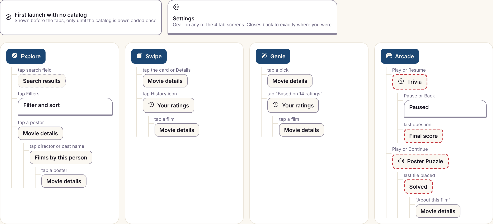
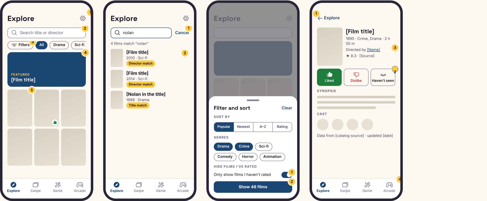
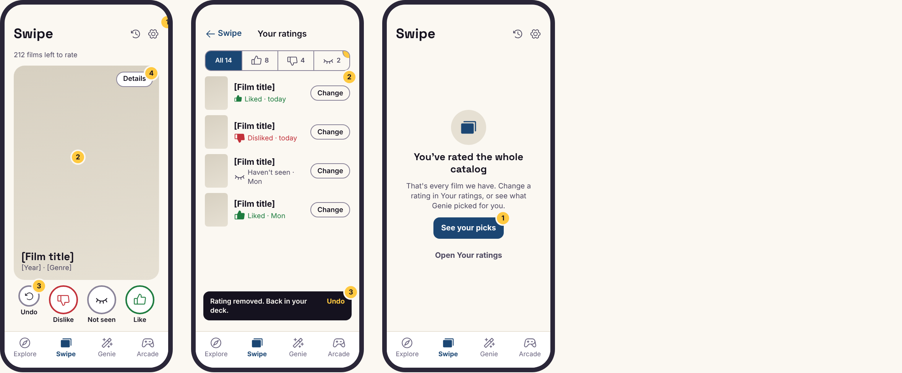
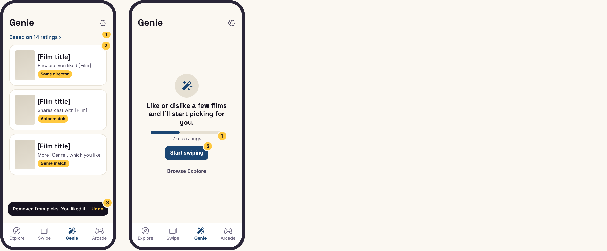
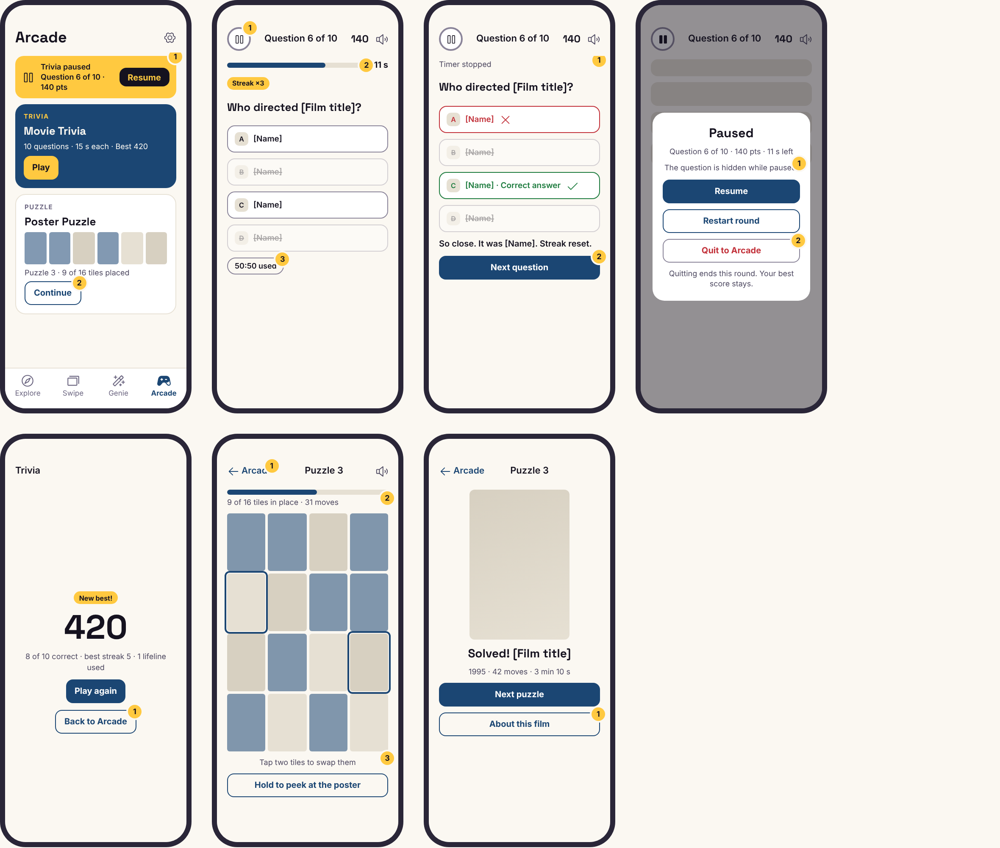
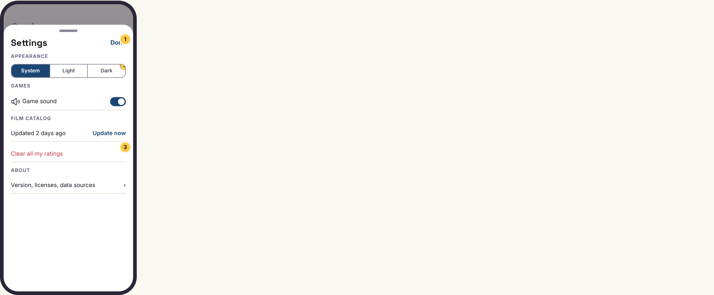
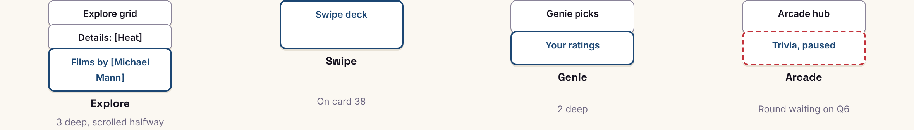
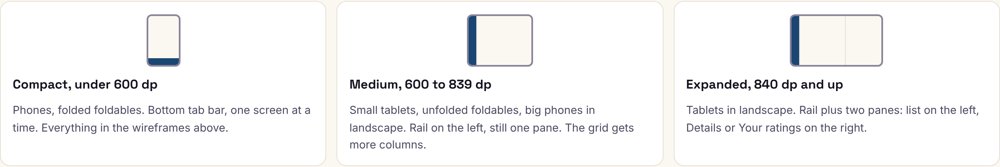
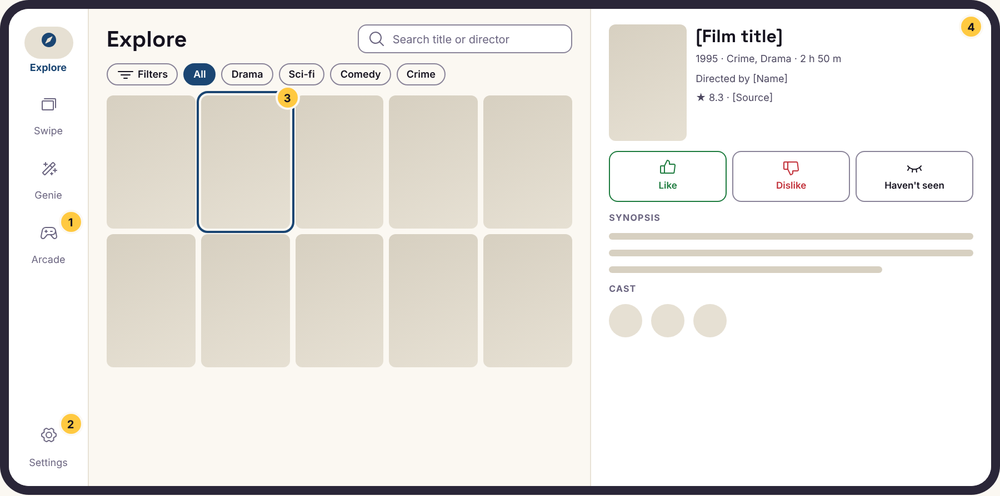
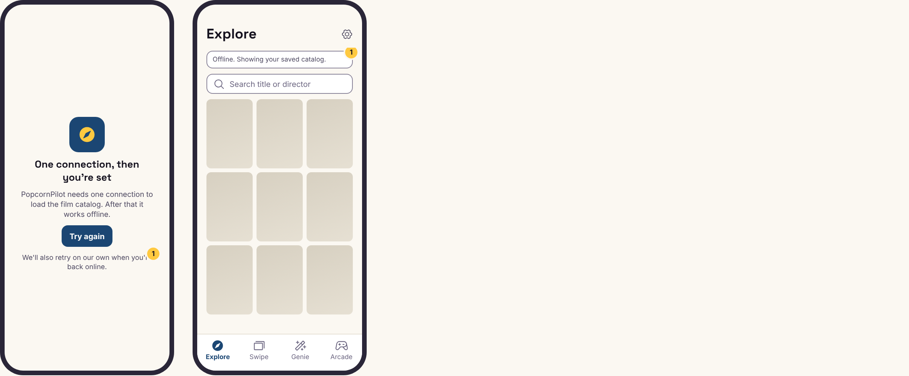

# PopcornPilot navigation

**Version 1.0, 17 Nov 2026. Approved by Kayla with no changes.** This document defines how people move around PopcornPilot: where every screen lives, what Back does, how each tab remembers your place, and what happens to a game when you leave it. It covers UX only. It is not code or an implementation plan.

It builds on the [brand manual](../brand/popcornpilot-brand-manual.md) (colors, type, voice) and the [UI icon set](../brand/icons/README.md) (Phosphor). The wireframes are low fidelity: grey blocks stand in for posters and text, and bracketed text is placeholder content. Yellow numbered dots on the wireframes match the numbered notes under each image.

**Contents**
1. [The 6 rules](#1-the-6-rules)
2. [Screen map](#2-screen-map)
3. [Wireframes](#3-wireframes)
4. [Keeping your place when you switch tabs](#4-keeping-your-place-when-you-switch-tabs)
5. [Leaving and returning to an active game](#5-leaving-and-returning-to-an-active-game)
6. [Back behavior on Android and iOS](#6-back-behavior-on-android-and-ios)
7. [Wide-screen variant](#7-wide-screen-variant)
8. [Empty, loading, error and offline states](#8-empty-loading-error-and-offline-states)
9. [Decisions](#9-decisions)

---

## 1. The 6 rules

Every screen follows these rules. If a later design choice breaks one of them, that's a sign the choice is wrong. Each rule has a plain version and the technical term you'll meet when building it.

| Rule | Plain version | Technical version |
|---|---|---|
| **1. Four rooms, one hallway** | Explore, Swipe, Genie and Arcade are always one tap away in the tab bar. Settings is a gear in the top corner of each of those four screens. | A bottom tab bar (`TabView` / `NavigationBar`) with 4 top-level destinations. Settings is a modal, not a destination. |
| **2. Each room keeps its own trail** | Opening a film in Genie stays in Genie. If you leave for Swipe and come back, the film is still open where you left it. | One navigation stack per tab (a `NavigationStack` per tab on iOS; on Android, a back stack per tab with `saveState` and `restoreState`). |
| **3. A tab name means "go there"** | If a button names a tab ("Start swiping", "See your picks"), it switches tabs. Everything else opens inside the tab you're already in. | Cross-links change the selected tab. All other links push onto the current stack. |
| **4. Back undoes your last step** | Back always goes to the screen you just came from, closes the sheet on top, or pauses a timed game. It never changes a rating. That's Undo's job. | Android `OnBackPressedDispatcher` / `BackHandler` with predictive back; iOS pop or dismiss. |
| **5. Games get the whole stage** | Trivia and Poster Puzzle hide the tab bar. You leave on purpose, through Pause or Back, and the game is paused or saved when you do. | Full-screen routes in the Arcade stack with the tab bar hidden. Game state is held outside the screen, so it survives leaving. |
| **6. Never a dead end** | Every empty, offline or error screen says what happened in plain words and offers one clear next step. | Each screen's UI state model has loading, content, empty, error and offline states. |

---

## 2. Screen map



Read each column top to bottom. Indented screens open from the one above them, and the grey text says what you tap. Movie details appears in several columns on purpose: it's one screen, and it opens inside whichever tab you're in.

**Legend**

| Look | Meaning |
|---|---|
| Navy fill | A tab's top level |
| Solid outline | Opens on top (push) |
| Thick bottom edge | Sheet |
| Dotted outline | Changes in place |
| Dashed red outline | Full screen, no tab bar |

**Text version of the map**

- **First launch with no catalog.** This screen appears before the tabs, and only until the catalog has been downloaded once.
- **Settings** (sheet). Opens from the gear on any of the 4 tab screens, and closes back to exactly where you were.
- **Explore**
  - Search results (changes in place). Opens when you tap the search field.
  - Filter and sort (sheet). Opens when you tap Filters.
  - Movie details. Opens when you tap a poster.
    - Films by this person. Opens when you tap a director or cast name.
      - Movie details
- **Swipe**
  - Movie details. Opens when you tap the card or Details.
  - Your ratings. Opens from the History icon.
    - Movie details
- **Genie**
  - Movie details. Opens when you tap a pick.
  - Your ratings. Opens when you tap "Based on 14 ratings".
    - Movie details
- **Arcade**
  - Trivia (full screen). Opens from Play or Resume.
    - Paused (sheet). Opens from Pause or Back.
    - Final score (full screen). Appears after the last question.
  - Poster Puzzle (full screen). Opens from Play or Continue.
    - Solved (full screen). Appears when the last tile is placed.
      - Movie details. Opens from "About this film".

### Shortcuts between tabs

| From | Button | What happens |
|---|---|---|
| Genie, when empty | "Start swiping" | **Switches to the Swipe tab**, because that's where rating happens. |
| Swipe, when the deck is finished | "See your picks" | **Switches to the Genie tab.** |
| Genie | "Based on 14 ratings" | **Stays in Genie.** It opens Your ratings inside Genie, so Back returns to your picks, not to Swipe. |
| Poster Puzzle, after solving | "About this film" | **Stays in Arcade.** It opens Movie details inside Arcade, and Back returns to the solved puzzle. |

---

## 3. Wireframes

The wireframes use the brand's light-mode tokens. In dark mode, the same layouts use the dark tokens from the brand manual.

### Explore



**Explore, top level**
1. **Settings gear** sits in this corner on all four tab screens, and nowhere else.
2. **Search lives inside Explore**, not in its own tab. Results replace the grid in place.
3. **Genre chips** filter in one tap. "Filters" opens a sheet for sort and for choosing several genres.
4. **The Featured film** hides while search or a filter is on, so results start at the top.
5. **Tap a poster** to open Details in this tab. Films you've rated show a small badge (an icon, not just a color).

**Search, in place**
1. **Cancel or Back** clears the search and puts you back on the grid at the same scroll spot.
2. **Each result says why it matched**, by title or by director, because the brief searches both.

**Filter and sort sheet**
1. **Optional extra:** hide films you've already rated. It's easy to drop if you want Explore to stay a plain catalog.
2. **The button shows how many films match** before you apply it, so you never land on an empty grid. Swiping the sheet down or pressing Back closes it without applying.

**Movie details**
1. **The back label names where you're going**: "Explore", "Picks", "Your ratings" or "Arcade".
2. **You can choose one of three marks.** Tap the selected one again to clear it. The selected mark shows the filled icon, the color and the word ("Liked").
3. **Director and cast names are links** to "Films by this person", in the same tab.
4. **The tab bar stays visible**, so you can jump away and come back to this film.

### Swipe and your ratings



**Swipe deck**
1. **The History icon** opens Your ratings. It sits apart from Undo because the two icons look alike.
2. **Swipe right to Like, left to Dislike, and down for Haven't seen.** Swiping up does nothing, so it can't conflict with the system's home gesture. The buttons do the same things for people who can't or don't want to swipe, and they double as VoiceOver and TalkBack actions.
3. **Undo brings back the last card.** It's a visible button because Back never undoes a rating.
4. **Details** opens this film inside Swipe. If you rate it there, the deck moves on when you come back.

**Your ratings (preference history)**
1. **Filter by mark.** Each filter shows a count. Icons are paired with numbers and labels for screen readers.
2. **Change** offers Like, Dislike, Haven't seen or Remove. Tapping the row opens Details.
3. **Removing a rating** puts the film back in the deck and lets Genie suggest it again. An Undo snackbar appears.

**Swipe, deck finished**
1. **"See your picks" switches to the Genie tab**, following rule 3 because it names a tab. A catalog update refills the deck.

### Genie



**Genie picks**
1. **The "Based on 14 ratings" link shows what Genie is working from.** It opens Your ratings inside Genie, so Back returns here.
2. **Every pick explains itself in words.** The badge is a label, never color alone.
3. **If you rate a pick in Details**, it leaves this list when you come back. An Undo snackbar appears so it doesn't just vanish.

**Genie, not enough ratings yet**
1. **A progress bar shows how close you are to the first picks.** The bar also has a text version for screen readers. The number 5 is a placeholder.
2. **"Start swiping" switches to the Swipe tab.** The copy comes straight from the voice examples in the brand manual.

### Arcade, Trivia and Poster Puzzle



**Arcade hub**
1. **A paused round shows at the top**, with where you left off. Starting a new round asks first, because it ends the paused one.
2. **The puzzle button says Continue** when a puzzle is in progress, and Play otherwise.

**Trivia, playing**
1. **There's no tab bar and no back arrow.** Pause is the way out, so the timer is never left running without you.
2. **The countdown shows seconds as text**, not only as a shrinking bar.
3. **50:50** crosses out two wrong answers, once per round.

**Trivia, answer reveal held**
1. **The answer stays on screen with the timer stopped** until you tap Next. This is how "hold reveal" from the brief is interpreted (confirmed).
2. **You move on when you're ready.** Wrong and right answers each show an icon, a color and words.

**Trivia, paused**
1. **The question is hidden while paused**, so pausing can't buy thinking time. This was added here; the brief doesn't mention it.
2. **Quit is the only button that loses progress**, and it says so.

**Trivia, final score**
1. **Back from here goes to the hub**, never back into the finished round.

**Poster Puzzle, playing**
1. **It has a normal back arrow**, because there's no timer. Leaving saves the puzzle without asking.
2. **Progress is shown in words and as a bar.**
3. **You swap tiles by tapping two of them** instead of dragging. That's easier one-handed and with VoiceOver or TalkBack.

**Poster Puzzle, solved**
1. **"About this film" opens Details inside Arcade**, where you can rate the film. Back returns here.

### Settings



1. **Done, a swipe down, or Back** closes Settings, and you're exactly where you were (Genie, in this example).
2. **Theme changes apply right away**, so you can see the change behind the sheet.
3. **Destructive actions ask you to confirm first** and explain what you'll lose.

Settings contains: Appearance (System / Light / Dark), Game sound, Film catalog (last updated, Update now), Clear all my ratings, and About (version, licenses, data sources).

---

## 4. Keeping your place when you switch tabs

**Plain version:** think of each tab as its own stack of cards on a table. Opening a screen puts a card on top of that tab's stack. Switching tabs means walking over to another stack, and the first one stays exactly as you left it.

**Technical version:** there are four independent back stacks. Each one has its own saved scroll position and screen state, and each stays alive while you're on another tab.



**An example**
1. **You're on Explore**, scrolled down the grid, reading Details for [Heat].
2. **You tap Swipe** and rate 3 films. The Explore stack sits untouched.
3. **You tap Explore again.** You're back on the [Heat] Details screen. Back takes you to the grid at the same scroll spot.
4. **You tap Explore once more** while you're already on it. That jumps to the top of the Explore stack, which is the grid. A second tap scrolls the grid to the top.

**What's remembered**

| What | While the app is open | After the app is fully closed |
|---|---|---|
| Which tab you were on | Yes | Yes, but it opens at that tab's top level (decision 5) |
| Screens open inside each tab | Yes | No. A cold start begins each tab at its top level |
| Scroll position | Yes, per tab and per screen | No |
| Explore search text | Yes | No. It starts empty |
| Explore genre filter and sort | Yes | Yes |
| Swipe deck position | Yes | Yes, because rated films have already left the deck |
| Likes, dislikes and "haven't seen" marks | Yes | Yes. This is the core data |
| Theme and game sound | Yes | Yes |
| Trivia round in progress | Yes, paused | No, but your best score is kept (decision 4) |
| Poster Puzzle in progress | Yes | Yes, tile by tile |

**Android detail worth knowing:** Android can quietly close an app that's in the background to free memory, then recreate it when you come back. Users expect that to look like nothing happened. So everything in the "while the app is open" column should also survive this. You'll meet this as *saved instance state* in Kotlin. iOS has a smaller version of the same idea, called *scene state restoration*.

---

## 5. Leaving and returning to an active game

The two games are opposites. Trivia has a clock, so leaving has to stop the clock. Poster Puzzle has no clock, so leaving can simply save. The rules follow from that.

### Trivia: pause on every exit

```
Playing ──(Pause, Back, app sent to background, phone call, lock screen)──▶ Paused
Paused  ──(Resume)──────────────────────────────────────────────────────▶ Playing
Paused  ──(Quit to Arcade)──────────────────────────────────────────────▶ Hub, round over
```

- Every way out goes through the Paused state first. No route leaves the timer running.
- Coming back to the app after a phone call shows the Paused dialog, never a question that's already counting down.
- The "Trivia paused" banner on the hub lets you resume after going elsewhere in the app.
- Starting a new round while one is paused asks: "End your paused round?"

### Poster Puzzle: save on every move

```
Playing ──(Back, app sent to background, app closed)──▶ Saved
Saved   ──(Continue on the hub)────────────────────────▶ Same tiles as before
```

- Each swap is saved right away, so even force-quitting the app loses nothing.
- Leaving doesn't ask for confirmation, because nothing is lost.
- After you solve a puzzle, "Next puzzle" picks a new poster, and the hub shows Play again.
- If the poster image isn't saved on the device (rare), the hub says so and offers a different puzzle.

---

## 6. Back behavior on Android and iOS

Android has a system Back, a gesture or a button, that works everywhere. Android 14 and later show a preview of where Back will take you as you start the gesture. iOS has no system Back, only the back button in the top bar and the swipe from the screen's left edge. This table lists both, so the two apps behave the same where it matters.

| Where you are | Android Back | iOS equivalent |
|---|---|---|
| Details, Your ratings, Films by this person | Previous screen in the same tab | Back button or edge swipe |
| Explore with search active | Clears the search; the grid comes back at the same spot | Cancel |
| Filter and sort sheet | Closes without applying | Swipe down |
| Settings sheet | Closes Settings | Done or swipe down |
| Top level of Swipe, Genie or Arcade | Switches to Explore (decision 8) | Nothing; iOS has no Back at the top level |
| Top level of Explore | Leaves the app | Home gesture |
| Swipe deck | Same as the top level. It never undoes a rating | Undo button only |
| Trivia, playing or showing an answer | Pauses and opens the Paused dialog. No "go back" preview | Pause button. Edge swipe is turned off |
| Trivia Paused dialog | Resumes the game | Resume |
| Trivia final score | Arcade hub | Back to Arcade |
| Poster Puzzle, playing or solved | Arcade hub (the puzzle is already saved) | Back button or edge swipe |
| Snackbar showing (Undo) | Ignored. Back acts on the screen, and the snackbar times out | Same |
| First launch, no catalog | Leaves the app | Home gesture |

---

## 7. Wide-screen variant

**Plain version:** on a wide screen, the tab bar moves to a slim column on the left, called a rail. Screens that would open on top of the list open beside it instead, so you see both at once.

**Technical version:** the window size class decides whether you get a navigation rail (Compose `NavigationRail`, or a sidebar-adaptable tab view on iPadOS). Explore, Swipe and Genie use list-detail panes.



| Size class | Devices | Layout |
|---|---|---|
| **Compact**, under 600 dp | Phones, folded foldables | Bottom tab bar, one screen at a time. Everything in section 3 |
| **Medium**, 600 to 839 dp | Small tablets, unfolded foldables, large phones in landscape | Rail on the left, still one pane. The grid gets more columns |
| **Expanded**, 840 dp and up | Tablets in landscape | Rail plus two panes: the list on the left, Details or Your ratings on the right |



1. **Same four destinations in the same order**, so muscle memory carries over from the phone.
2. **Settings moves to the bottom of the rail** because there's room for it, so it no longer needs a gear on each screen. It opens as a sheet about the size of a dialog, in the middle of the screen.
3. **The selected poster is outlined**, so you can see which film the right pane is showing.
4. **Details opens beside the grid.** Android Back first clears the right pane, then works the same as on a phone. If you rotate from two panes to one, Details stays open as a normal screen on top of the grid.

| Tab | Left pane | Right pane |
|---|---|---|
| Explore | Grid, search, filters | Details of the selected film, or "Pick a film to see its details" |
| Swipe | The card deck, centered | Your ratings, updating live, so each swipe appears at the top |
| Genie | Picks list | Details of the selected pick |
| Arcade | Single pane. Games stay centered at phone width with the rail hidden, so tiles and answer buttons don't stretch. | |

---

## 8. Empty, loading, error and offline states

The copy is written in the brand's "film buff friend" voice.



- **First launch, offline:** there's no tab bar yet, because every tab needs the catalog. This is the only screen that can block the app.
- **Later, offline:** a small banner appears instead of a blocking screen. Everything still works from the saved catalog, and the banner goes away once you're back online.

| Where | State | What it says | Next step |
|---|---|---|---|
| First launch | Downloading the catalog | *Loading the film catalog… 1,240 of 3,000 films* | Progress bar. The tabs appear when it's done |
| First launch | Offline, no catalog | *PopcornPilot needs one connection to load the film catalog. After that it works offline.* | Try again, plus an automatic retry once back online |
| Explore | Loading (on later launches) | *(poster-shaped placeholders, no text)* | Fills in from the saved catalog in a moment |
| Explore | Offline | *Offline. Showing your saved catalog.* | None needed |
| Explore search | No results | *No films match "nolam". Try a title or a director's last name.* | Clear search |
| Explore filters | No results | *No [Horror] films in [A–Z] that you haven't rated.* | Clear filters |
| Any poster | Image missing while offline | *(the title on a navy tile in place of the poster)* | Fills in once online |
| Catalog update | Update failed | *Couldn't update the catalog. You still have the version from [date].* | Try again (in Settings) |
| Swipe | Deck finished | *You've rated the whole catalog.* | See your picks / Open Your ratings |
| Your ratings | Nothing rated | *Nothing rated yet. Your likes and dislikes will show up here.* | Start swiping |
| Genie | Too few ratings | *Like or dislike a few films and I'll start picking for you.* | Start swiping / Browse Explore |
| Genie | Nothing left to pick | *I've run out of picks you haven't rated. Check back after the next catalog update.* | Browse Explore |
| Trivia | Too little data for a round | *Trivia needs a bigger catalog. Connect once to load more films.* | Back to Arcade |
| Arcade | No best score yet | *Best: none yet* | Play |

---

## 9. Decisions

Kayla approved every recommendation on 17 Nov 2026. The rejected options are kept here so the reasoning is clear if one is revisited.

| # | Question | Decision | Options not chosen | Why |
|---|---|---|---|---|
| 1 | Where does Settings live? | **A gear on each tab's top level.** It's hidden on Details and inside games | A fifth tab; inside Arcade or a profile menu | Theme and sound change rarely, so Settings shouldn't take a tab. A gear in the top corner is the convention on both platforms. |
| 2 | Where does the ratings history live? | **In Swipe, and also linked from Genie.** It's one screen that opens inside whichever tab you came from | In Settings as "My ratings"; its own tab | You review history right after swiping (to undo a mistake) and when Genie surprises you (to see why). |
| 3 | Should games hide the tab bar? | **Yes, while playing.** You leave through Pause or Back | Keep the tab bar visible and auto-pause on a tab switch | Trivia is timed, so a stray tap shouldn't cost you a streak. With only two exits, "pause on every exit" stays simple. |
| 4 | What happens to a Trivia round if the app is fully closed? | **The round ends and the best score is kept.** Poster Puzzle still resumes | Resume mid-round after a restart | Rounds are about 3 minutes, so little is lost. Resuming would mean saving the timer, lifelines and streak to disk, which is a possible learning exercise later. |
| 5 | Which tab opens after a cold start? | **The last tab you used, at its top level** | Always Explore | People often use this kind of app for the same one thing each visit. Opening at the top level avoids landing on an old Details screen. |
| 6 | Where does search go? | **Inside Explore, with results in place** | A separate Search screen | Search and browse do the same job. The catalog is offline and small enough for instant results. |
| 7 | Is Details a full screen or a sheet? | **A full screen, opened inside the tab** | A bottom sheet over the list | Details links onward to cast and other films. A sheet on top of a sheet gets confusing. |
| 8 | What does Android Back do at the top level of Swipe, Genie or Arcade? | **It goes to Explore, and the next Back leaves the app** | Leave the app right away; retrace your tab history | This is Google's recommended pattern. One consistent stop before exiting is easy to learn. |
| 9 | Wide screens: a rail or a stretched tab bar? | **A rail, plus two panes when there's room** | Keep the bottom tab bar, just wider | It's the platform default on both sides, and it uses the extra width well. |

**Interpretations of the brief (confirmed by Kayla)**
- **"Hold reveal" in Trivia:** after you answer, the correct answer stays on screen with the timer stopped until you tap Next.
- **"Preference history":** the Your ratings list (likes, dislikes, haven't seen), where you can change or remove any rating.

**Still a placeholder:** Genie's minimum of 5 ratings before it shows picks.
